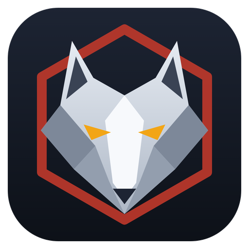

<p align="center">
  
</p>

<h1 align="center">Wolves</h1>

<p align="center">
  <b>Turns your Dead by Daylight installation into ready-to-use profile and market files.</b><br>
  One click, no setup, no manual editing.
</p>

<p align="center">
  
  
  
</p>

---

## What it does

Wolves reads the game files of your installed **Dead by Daylight** and builds a set of JSON files from them:
every character, perk, item, add-on and offering that exists in your game version, plus complete
bloodweb, inventory and market data in the same format the game itself uses.

Because everything comes straight from your own game files, the result always matches your game version.
When the game updates, just run Wolves again.

## Quick start

1. **Download** the latest release and unpack it anywhere.
2. **Run** `Wolves.exe`.
3. **Pick a mappings file** (`.usmap`) for your game version when asked.
4. **Done.** Wolves finds the game by itself and writes everything to the `Extracted` folder next to the exe.

> [!TIP]
> Wolves finds Steam and Epic Games installs automatically. If your game lives somewhere else,
> it asks you to point at the folder once and remembers it for next time.

## What you get

All files are written to the `Extracted` folder.

| File | What's inside |
| :--- | :--- |
| `Characters.json` | Every survivor and killer, with names, roles and DLC info |
| `Perks.json` · `Items.json` · `Addons.json` · `Offerings.json` | Everything a character can equip |
| `ItemsList.json` | A short list of all perk, item, add-on and offering ids |
| `Bloodweb.json` | A fully completed bloodweb with every item in the inventory |
| `GetAll.json` | The same full inventory for every character at once |
| `MarketFull.json` | Every cosmetic from the store catalog |
| `MarketDLC.json` | Default cosmetics plus every character |
| `ZLIB.py` | A small helper for packing and unpacking files ([see below](#zlibpy)) |

## Requirements

- Windows 10 or 11, **64-bit**
- [.NET 10 Runtime](https://dotnet.microsoft.com/download/dotnet/10.0)
- A `.usmap` mappings file that matches your game version
- Internet access on the first run (a small decompression library is downloaded once)

## `ZLIB.py`

A drag-and-drop helper that sits in the `Extracted` folder. Drop any file onto it:

- **a regular file** gets compressed and encoded (ZLIB + Base64),
- **an already encoded file** gets decoded back,

and the result is copied straight to your clipboard. Needs [Python 3](https://www.python.org/downloads/).

## Troubleshooting

| Problem | Solution |
| :--- | :--- |
| The game is not found | Pick the game folder in the dialog, or drop the folder onto `Wolves.exe` |
| Wrong game folder was remembered | Delete `Wolves.settings.json` next to the exe and run again |
| "No archives could be mounted" | Read the warnings above the error. Usually the game was updated and Wolves needs a newer version |
| Anything else | The full error is saved to `Wolves.error.log` next to the exe. Attach it when reporting an issue |

---

<details>
<summary><b>For developers</b></summary>

### Building

Requires the **.NET 10 SDK**. Open `Wolves.slnx` in Visual Studio 2026 (or run `dotnet build`).
NuGet restores everything, including [CUE4Parse](https://github.com/FabianFG/CUE4Parse), and the Oodle
decompressor is downloaded and placed next to the exe during the build.
Publish with the `FolderProfile` profile (`win-x64`).

### How it works

1. Asks for a `.usmap` file and copies it to `Extracted\mappings.usmap`.
2. Locates the game: command-line argument → saved path → Steam → Epic Games → folder picker.
3. Mounts the game archives with CUE4Parse and reads `ItemDB`, `ItemAddonDB`, `OfferingDB`, `PerkDB` and `CharacterDescriptionDB`.
4. Generates `Bloodweb.json`, `GetAll.json` and `ItemsList.json`.
5. Generates `MarketFull.json` and `MarketDLC.json` from `Defaults\`.

### Project layout

| File | Purpose |
| :--- | :--- |
| `Program.cs` | Runs the five steps above, error reporting |
| `Cue4Parse.cs` | Mounting the game and reading the databases |
| `GameLocator.cs` | Finding the game folder |
| `CatalogGenerator.cs` · `CatalogModels.cs` | Building the generated JSON files |
| `FileOpenDialog.cs` · `ConsoleWindow.cs` | Native Windows dialogs, console title and icon |
| `Models.cs` | AES key and the extracted data model |
| `Defaults\` | Default cosmetics and the decrypted store catalog used for the market files |

### Settings

| Where | Setting | Default |
| :--- | :--- | :--- |
| `Wolves.csproj` | `Version` | `1.1.0` |
| `Wolves.csproj` | `CUE4Parse` package version, `OodleRelease` | Bump when the game updates |
| `Models.cs` | `AesKey` | Dead by Daylight AES key |
| `CatalogGenerator.cs` | Perk / item / add-on / offering quantities | `3` / `50` / `50` / `50` |
| `CatalogGenerator.cs` | Bloodweb level, prestige | `30`, `0` |
| `CatalogGenerator.cs` | `MarketProvider` (the `provider` field of the market files) | `Wolves` |

> [!NOTE]
> `Defaults\Catalog.decrypted.json` is a snapshot of the store catalog. Replace it with a newer one
> when new cosmetics are released.

### Output format

<details>
<summary><code>GetAll.json</code></summary>

```json
{
  "list": [
    {
      "characterName": "Dwight",
      "legacyPrestigeLevel": 0,
      "characterItems": [ { "itemId": "Item_Camper_DullKey", "quantity": 50 } ],
      "bloodWebLevel": 30,
      "bloodWebData": { "paths": [], "ringData": [] },
      "isEntitled": true,
      "isScopesValid": true,
      "origin": {
        "entitlements": [],
        "purchaseInfo": { "lastUpdateAt": 1760536260, "objectId": "Dwight", "quantity": 1 }
      },
      "prestigeLevel": 0
    }
  ]
}
```
</details>

<details>
<summary><code>MarketFull.json</code> / <code>MarketDLC.json</code></summary>

```json
{
  "fileType": "Market File (Full)",
  "creationDate": "16.10.2026 09:54",
  "provider": "Wolves",
  "inventoryItems": [ { "lastUpdateAt": 1760541000, "objectId": "D_Head01", "quantity": 1 } ]
}
```
Ids containing any word from `MarketExcludedSubstrings` (by default `Bundle`) are always skipped. Characters are excluded from **Full** and included in **DLC**.
</details>

<details>
<summary><code>ItemsList.json</code></summary>

```json
{
  "perks": [ "Bond" ],
  "items": [ "Item_Camper_DullKey" ],
  "addons": [ "..." ],
  "offerings": [ "..." ]
}
```
</details>

</details>

## License

[MIT](LICENSE)
